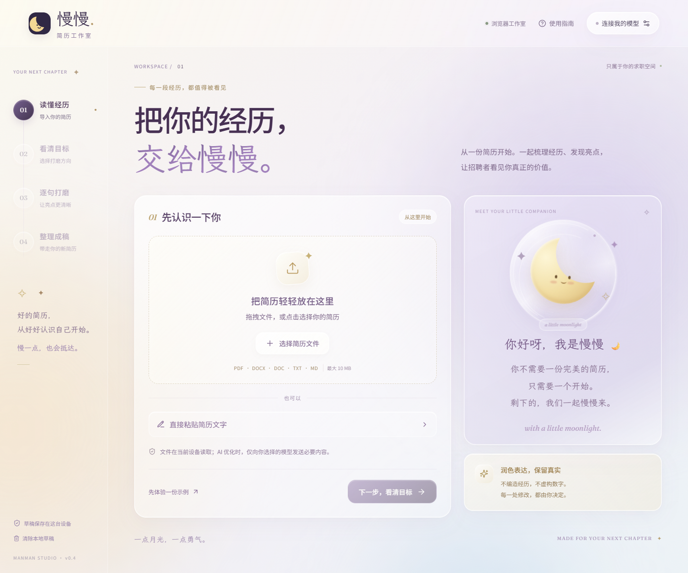

# 慢慢🌙 · 简历工作室

一点月光，一点勇气。一个支持网页使用与 Windows 本地部署的简历优化工作室：自带 API Key，导入已有简历，查看有依据的优化建议，逐条决定，再导出 PDF 或可编辑的 Word。

**[在线使用](https://virtue192.github.io/manman-resume/) · [公开源码](https://github.com/virtue192/manman-resume) · [下载源码 ZIP](https://github.com/virtue192/manman-resume/archive/refs/heads/main.zip)**

采用 MIT 开源许可。React 工作台结合月亮伙伴、玻璃材质、可变字体、月牙鼠标和月光点击反馈；使用成熟的开源解析与文档生成库。



## 网页版与本地版

| 能力 | GitHub Pages 网页版 | Windows 本地版 |
| --- | --- | --- |
| PDF / DOCX / TXT / MD 导入 | 在浏览器中读取 | 本机服务读取 |
| DOC 导入 | 先用 Word 另存为 DOCX | 可通过 LibreOffice 转换 |
| BYOK 优化 | 浏览器直接请求你选择的 API，需支持 CORS | 本机服务转发，不受浏览器 CORS 限制 |
| Word 导出 | 浏览器生成并直接下载 DOCX | 本机服务生成 DOCX |
| PDF 成稿 | 点击“打印 / 保存 PDF”，在浏览器打印窗口另存为 PDF | 直接下载 PDF |
| Ollama | 受浏览器 HTTPS / 本机访问限制，建议用本地版 | 支持本机 Ollama |
| 草稿 / Key | 草稿只在当前浏览器，Key 只在页面内存 | 同左 |

网页版没有后端，没有项目方代管的 Key，也没有上传简历到 GitHub 的接口。用户配置的模型服务会收到优化所需的简历文字和岗位描述。模型连接测试也会向该服务商发送请求。

如果网页提示跨域或网络错误，检查服务商是否允许浏览器调用，或使用本地版。不要为了测试在网页填入来源不明的 API 地址。没有 Key 时，可先使用明确标注的虚构示例。

## GitHub Pages 部署

项目默认仓库路径为 `/manman-resume/`。推送 `main` 后，`.github/workflows/pages.yml` 会构建并部署 `dist-pages`。仓库 Settings → Pages 的发布来源需选择 **GitHub Actions**。

```powershell
npm ci
npm run build:pages
npm run preview:pages
```

本地静态预览：http://127.0.0.1:4319/manman-resume/ 。如果改用其他仓库名，请同步修改 `vite.config.ts` 中的 Pages `base`。

CI 不需要任何模型 Key；不要添加模型 Key 到 GitHub Actions Secrets、构建变量或源码。Pages 构建只发布网页资源，本地后端源码供下载运行。

## Windows：双击启动

1. 安装 **Node.js 22.13+**，推荐 Node.js 24 LTS。
2. 解压项目，双击 **`start.cmd`**。
3. 首次启动会根据锁文件安装依赖、构建页面，然后打开 **http://127.0.0.1:4317**。
4. 保持命令窗口开启；关闭窗口停止服务。

首次安装需要联网。后续启动使用本地依赖；云模型优化仍需要网络。本地 Ollama 可以离线使用。不需要 Docker 或数据库。

手动运行：

```powershell
npm ci
npm run build
npm start
```

开发模式：`npm run dev`，访问 http://127.0.0.1:5173。

## 使用流程

1. **读懂经历**：导入文件或粘贴文字。核对联系方式、日期、经历和段落顺序。也可以先体验虚构示例。
2. **看清目标**：可选粘贴岗位 JD，选择自然专业、简洁有力或突出贡献。
3. **逐句打磨**：查看原文、改写和理由。逐条采纳、撤回；新增数字会标记为待核实。模型不能唯一对应原文的建议会被过滤。没有自动生成的招聘通过率。
4. **整理成稿**：自由编辑，选择经典专业、月光简约或纯粹黑白，下载 PDF / DOCX / TXT / Markdown。

“备份草稿”会导出 JSON，包含原文、岗位描述、修改建议、已采纳的修改及成稿。之后用导入文件入口选择此 JSON 即可恢复，不包含 Key。

## BYOK 模型配置

右上角 **连接我的模型** → 填写 Key、模型名称和 API 地址 → **测试连接** → 完成设置。

| 服务 | 接口方式 |
| --- | --- |
| TokenDance / 词元跳动 | 选择预设即可填入网关地址；模型 ID 以平台当前列表为准 |
| DeepSeek | 原生 OpenAI 兼容 Chat Completions |
| OpenAI | Chat Completions；使用支持 `temperature` 和 JSON 输出的对话模型 |
| OpenRouter | OpenAI 兼容 Chat Completions |
| 自定义接口 | Base URL + 模型 ID + Key，需支持 Chat Completions 与 JSON 输出 |
| Ollama | 本地 `/api/chat`，无需 Key；例如 `http://127.0.0.1:11434` |

API 地址通常填写服务商的 `/v1` 根地址；完整 `/chat/completions` 地址也可使用。原生 Anthropic / Gemini 协议尚未实现，可通过 OpenRouter 或其他兼容网关接入。某些推理模型不接受 `temperature` 或 `response_format`，需要选择兼容的对话模型。

使用 Ollama 前先安装、启动服务并下载对应模型，例如 `ollama pull qwen3:8b`。建议优先使用中文表达和 JSON 输出较稳定的模型。

**Key 仅保存在当前页面内存中**。网页模式直接发送给用户配置的服务商，本地模式通过自己的本机服务转发。刷新、关闭页面后需要重新填写。不会写入本地草稿、环境文件、请求日志或导出文件。连接测试会发送一条简短请求，可能产生少量服务商费用。

## 文件支持

| 格式 | 导入 | 导出 | 说明 |
| --- | --- | --- | --- |
| PDF | 是 | 是 | 导入可选中文字的 PDF；导出使用本机 Edge / Chrome / Chromium |
| DOCX | 是 | 是 | 导出可编辑 Word，含中文字体设置 |
| DOC | 条件支持 | 否 | 导入需安装 LibreOffice，先转 DOCX；输出使用现代 DOCX |
| TXT / MD | 是 | 是 | UTF-8 编码 |
| JSON 草稿备份 | 是 | 是 | 本应用导出的 JSON，非 JSON Resume 标准 |

单文件最大 **10 MB**；简历最大 **60,000 字符**，岗位描述最大 **20,000 字符**。文件默认在内存中处理。DOC 转换会使用独立临时目录，处理后删除。

当前导入提取**内容**，不保留原文件复杂排版；导出会按选择的模板重新排版。扫描 PDF 暂不内置 OCR。图片、头像、复杂表格与多栏文件的阅读顺序需要人工核对。

正式 PDF 使用 A4，中文字体优先采用 Windows 微软雅黑。Windows 已安装的 Edge 会自动检测；若找不到，可设置 `BROWSER_PATH`，或运行：

```powershell
npx playwright install chromium
```

DOC 支持：安装 LibreOffice 后会自动检测常见安装位置，也可设置 `LIBREOFFICE_PATH`。不需要为了 DOCX 安装 Word 或 LibreOffice。

```powershell
$env:LIBREOFFICE_PATH = 'C:\Program Files\LibreOffice\program\soffice.exe'
$env:BROWSER_PATH = 'C:\Program Files (x86)\Microsoft\Edge\Application\msedge.exe'
npm start
```

`.env.example` 仅列出可选环境变量；程序不会自动读取 `.env`，请在 PowerShell 中设置变量。

## 视觉与动效

- **v0.3 月光鼠标与文楷**：根据你提供的 [自定义鼠标参考](https://vibe-design-labs.github.io/Vibe-UI-UX/studio.html?item=custom-cursor) 和 [聚光参考](https://vibe-design-labs.github.io/Vibe-UI-UX/studio.html?item=cursor-spotlight)，独立实现了慢慢主题的 SVG 鼠标、暖金淡紫聚光和点击涟漪 / 星点，未引入参考网站的代码、字体或在线运行依赖。
- 鼠标尖端与真实点击坐标一致；只有光晕使用约 85ms 的柔和追随。聚光半径约 175px，按钮上有悬停和按下状态。数值是本项目方案起点，不是行业标准。
- 输入、简历预览、修改前后文字区保留原生指针；Tab、Esc、窗口失焦、滚动和触屏会退出自定义鼠标。系统减少动效与强制颜色模式下使用原生指针。装饰层不接收点击，快速连点时最多保留 6 组涟漪，结束后释放节点。
- 标题第二行、品牌和陪伴文案采用 **霞鹜文楷（LXGW WenKai）**，文档正文仍使用 Noto Sans SC。字体 WOFF2 在项目内提供，许可见 `public/licenses/lxgw-wenkai-OFL.txt`，已核对字体包含「慢慢、月光、经历」等所需汉字。
- 角色延续本项目此前的 `moon.svg` 和 `MoonFriend`：奶油月牙、微笑、淡紫与暖金。不为角色编造新的历史背景或外部 IP 身份。
- **v0.2 月光玻璃升级**：中文使用随项目打包的 Noto Sans SC 可变字体，英文使用 Fraunces 可变衬线字体。主要标题约 48–68px，桌面功能文字 12–15px，手机独立适配。
- 标题按字响应鼠标距离：靠近时轻微抬升、旋转并增加字重，离开后回弹；不改变正文排版，也不在触屏和减少动效模式中触发。
- 鼠标移动驱动卡片局部光晕与蒙版边缘高光，按钮使用弹簧式轻微吸附和光泽扫过。
- 多层玻璃材质包含磨砂背景、通透渐变、内沿高光、柔和阴影，以及月亮外围的玻璃圆镜、流动高光和蒙版光纹。这是 CSS 渲染的玻璃视觉效果，不依赖 Apple 私有框架。
- 背景加入轻微漂移的紫、奶油色与蓝色柔光，蒙版网格和细腻噪声；不会拦截鼠标或遮挡输入。
- 奶油白工作台、深紫字色、月光黄点缀，无需加载网络字体或素材。
- 原创矢量 / CSS 月亮伙伴：轻微悬浮、眨眼、柔光呼吸、星光闪烁。
- 页面进出、步骤指示、按钮悬停与按下、折叠输入区、采纳状态及弹窗过渡。
- 模型处理状态使用不定进度月光动画，不展示虚假的完成百分比。
- 响应式桌面 / 手机布局，键盘焦点、弹窗焦点循环及 Esc 关闭。
- 尊重系统“减少动态效果”设置，保留完整功能。

## 本地数据与访问边界

草稿自动保存在当前浏览器 `localStorage`，不加密，适合自己的电脑。左下角可清除草稿；共享设备上使用后应清除。本应用不设置云账号，也不上传文件到项目作者的服务器。

云模型会收到你主动提交的简历文字与岗位描述。使用本机 Ollama 时，请求留在本机。没有遥测、分析统计或外部字体请求。

默认服务仅监听 `127.0.0.1`，并检查 Host 和 API 请求来源。定位是**单用户本机工具**，不作为多人公开 SaaS 部署。多人账号、凭据隔离、请求限额和服务端鉴权不在本版本中。

## 可选 Docker

```powershell
docker build -t manman-resume .
docker run --rm -p 127.0.0.1:4317:4317 manman-resume
```

镜像包含 Chromium、中文字体和 LibreOffice。在 Windows 上需要 Docker Desktop 的 Linux 容器环境。容器访问宿主 Ollama 可将地址改为 `http://host.docker.internal:11434`，原生方式继续使用 `http://127.0.0.1:11434`。

Docker 配置已提供，但当前交付环境 Docker 引擎未运行，**尚未实测镜像构建**。Windows 原生启动与 Edge 导出已验证。

## 验证

```powershell
npm test
# 先运行 npm start，再执行浏览器检查：
npm run test:ui
# 字体、鼠标交互、玻璃与响应式视觉检查：
npm run test:visual
npm run test:pointer
npm run test:pages # 先运行 npm run preview:pages
```

测试覆盖：原文定位、重叠修改过滤、新增数字确认、转义、外部来源拒绝、BYOK 请求转发、中文 PDF / DOCX 导出与重新导入。浏览器检查覆盖示例完整流程、采纳 / 撤回、成稿编辑、下载、草稿持久化、Key 不落盘、弹窗键盘、手机宽度及减少动效设置。

模型接口集成使用本机模拟服务验证；没有代填 Key，也没有用真实付费 Key 请求云模型。首次使用时请在设置中测试你的真实服务商连接。

## 项目结构

```text
src/                 React 工作台、动效、样式及虚构示例
src/FluidExperience.tsx  鼠标感应标题、背景柔光与玻璃圆镜
src/fluid.css        v0.2 玻璃材质与放大的字体系统
src/MoonPointer.tsx  v0.3 月牙指针、聚光、点击涟漪与降级
src/moon-type.css    手写感品牌与陪伴文案字体
public/licenses/    随项目打包字体的 SIL OFL 许可
server/index.mjs     本机 API、文件导入、模型请求与导出
server/core.mjs      输入 / 输出校验、原文对应及 HTML 转义
server/model.mjs     模型适配与编辑提示词
server/files.mjs     PDF / DOCX / DOC 解析与成稿生成
scripts/launch.mjs   Windows 启动准备与浏览器打开
tests/               单元、接口与浏览器检查
start.cmd            Windows 双击入口
```

## 开源许可

本项目代码及原创月亮视觉采用 MIT 许可，见 `LICENSE`。依赖使用各自许可证。主要依赖：React、Vite、Motion、Lucide、Express、Mammoth、pdf-parse、docx、Playwright、Zod。

Noto Sans SC 与 Fraunces 字体采用 SIL Open Font License，许可随构建输出放在 `public/licenses/` 中。字体文件来自 Fontsource 包，浏览器直接从本地服务读取，不请求 Google Fonts。

霞鹜文楷来自 `@fontsource/lxgw-wenkai@5.3.0`（上游 [lxgw/LxgwWenKai](https://github.com/lxgw/LxgwWenKai)），采用 SIL Open Font License。项目保留原字体文件及许可；本次只设计字距、字号与使用位置，没有声称创作了该字体。

仓库包含网页版和完整 Windows 本地版。当前版本不内置扫描件 OCR，也不承诺 AI 能核验所有事实；投递前请核对日期、岗位、数字和经历。
